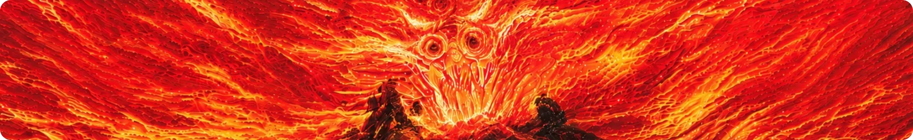
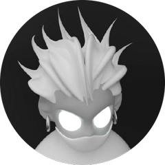
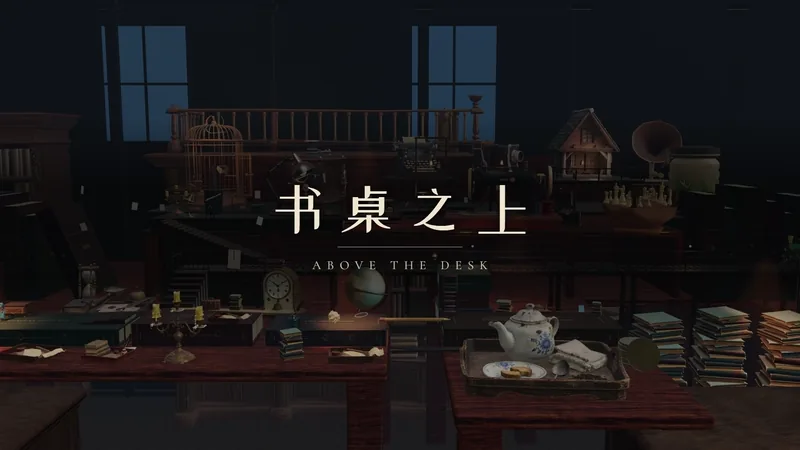
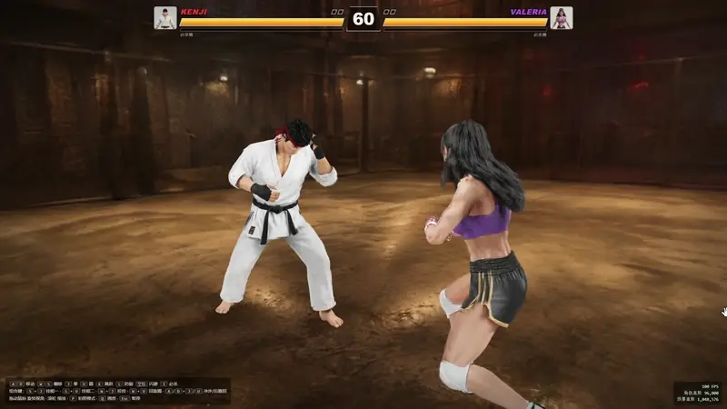
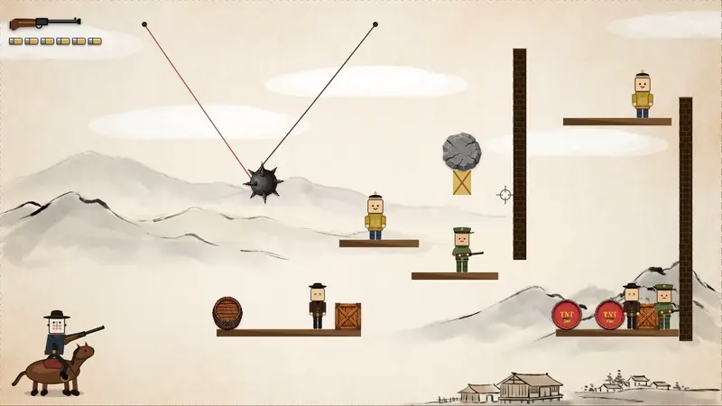

 

### 小奇说

🌱 **关于我**：科技爱好者，热爱生活、分享与聆听，活到老学到老 
💬 **找到我**：制作过程都会发在下面这些平台，欢迎礼貌私信交流

 

  
  
  
  
  

 

<h1 align="center">🎮 AI 游戏展</h1>

用 AI 做的游戏，点开浏览器就能玩

### 🕯️ 书桌之上 · Above the Desk

> 午夜，一个小人在巨人的书桌上开始漫长的旅程：铅笔搭成桥，躲开巨手，乘上夜航小火车，按下打字机印出遗失的书页。

 

### 🥊 Splat Fighter · 高斯泼溅格斗

> 网页 1v1 格斗。角色、动作和擂台全部由 PINOC 生成，3D 高斯泼溅实时渲染。4 名格斗家、4 张地图、必杀演出，手机横屏也能玩。

 

### 🔫 让子弹飞

> “让子弹飞”风格的物理解谜射击小游戏：算好角度，一颗子弹解决所有问题。

 
 

<h1 align="center">🧰 工具箱</h1>

Agent Skill、动画和网页模板

| 项目 | 类型 | 简介 | Stars |
| --- | --- | --- | --- |
| [Obsidian-through](https://github.com/Wh1tZz/Obsidian-through) | Agent Skill | 免费、私密的 Obsidian 四端同步，走 GitHub |  |
| [xiaoqishuo-card](https://github.com/Wh1tZz/xiaoqishuo-card) | Agent Skill | 上传一张卡面，生成可交互的 Three.js 全息景深卡片 |  |
| [Tibo-Please](https://github.com/Wh1tZz/Tibo-Please) | 动画 | 用 Remotion 写成的 Codex 动画 |  |
| [Creator-AI-Homes](https://github.com/Wh1tZz/Creator-AI-Homes) | 网站模板 | 面向独立创作者的开源 AI / 自媒体个人网站模板 |  |
| [worldcup-2026-site](https://wh1tzz.github.io/worldcup-2026-site/) | 网页 | 2026 世界杯主题落地页 |  |
